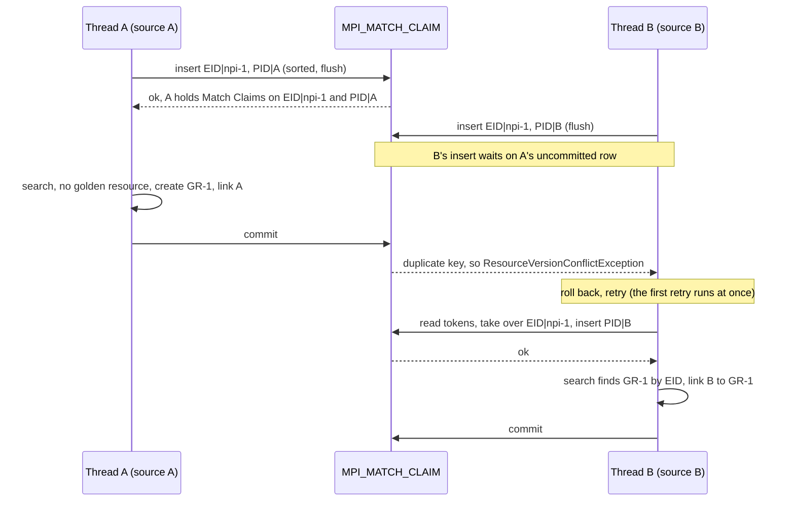
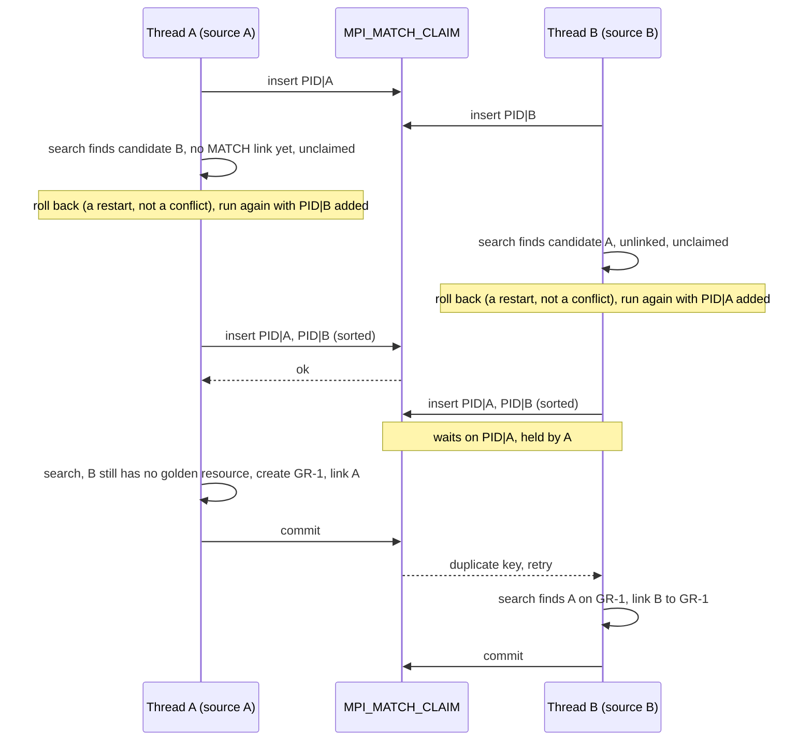

<!-- Created by Claude Opus 5.5 -->
# HAPI FHIR JPA Server MDM

This README covers how MDM processes sources concurrently without creating duplicate golden resources: the Match
Claim design. The rest of the module is documented in its javadoc and in the
[MDM documentation](https://hapifhir.io/hapi-fhir/docs/server_jpa_mdm/mdm.html). The test plan for this design is in
`src/test/java/ca/uhn/fhir/jpa/mdm/svc/concurrency/package-info.java`.

In short: MDM uses the database as a cluster-wide lock. Each unit of work inserts a row whose primary key is a hash of
what it is processing, and holds its JDBC transaction open until it has linked the source. A second unit of work that
inserts the same key blocks on that row until the first ends, then fails with a duplicate key and retries.

## The Problem

MDM processes one source at a time per unit of work: search for candidates, decide, then link the source to a golden
resource or create a new one.

With several MDM consumers or several nodes, two units of work for sources that match
each other can both search before either commits.

Each sees no golden resource for the other, so each creates its own.

Result: two golden resources where one is expected.

## The Solution: Match Claims

A unit of work first inserts a **Match Claim** for everything its decision depends on.

A Match Claim is a row in `MPI_MATCH_CLAIM`, stored as `MdmMatchClaimEntity`, that records that one unit of work is processing
a given source or EID. It is not the act of claiming: a unit of work *claims* a key by inserting a Match Claim for it, and only then searches.

The `MPI_MATCH_CLAIM` table's primary key is a hash of the Match Claim's canonical key
(the text that names what is claimed, always the same for the same resource or EID, e.g. `PID|Patient|1234`; see the table below).

Two units of work that claim the same key cannot both hold it.

The second insert blocks inside the database (no busy-waiting: the thread sits in the JDBC call) until the first
transaction ends:

* the first commits: the second insert fails with a duplicate key;
* the first rolls back: its row is gone, so the second insert succeeds and that unit of work carries on;
* the database's lock timeout expires first: the second insert fails with a lock timeout or deadlock.

A duplicate key, lock timeout or deadlock is reported as a Match Claim conflict.
The loser retries, and its new search sees what the winner committed. This is the pattern
conditional creates use with the search URL table.

Units of work that share no Match Claim never touch the same row, so sources that don't match each other still run in
parallel.

### What Is Claimed

The keys are built by `MdmMatchClaimKeySvc`. In each unit of work the **source** is the resource being processed and
the **candidates** are the sources its candidate search returns *and* scores as a MATCH or POSSIBLE_MATCH. A source
the blocking search returns but that scores NO_MATCH is never claimed.

| Match Claim | Key | Taken | Why |
|---|---|---|---|
| The source | `PID\|<type>\|<pid>` | before the search | serializes two units of work for the same source |
| Each external EID of the source | `EID\|<type>\|<system>\|<value>` | before the search | sources sharing an EID must agree on one golden resource |
| Each candidate source with no MATCH link yet | `PID\|<type>\|<pid>` | on a restart, before the repeated search | the candidate may be mid-processing on another thread |

The Match Claim on a candidate and that candidate's own source Match Claim have the same key, so a unit of work that finds an unlinked
candidate collides with whichever unit of work is processing that candidate.

Candidates that already have a MATCH link do not need to be claimed: their golden resource is committed,
so the outcome is already stable.

#### On Partitions

Match Claims are not scoped by partition. The same source or EID can reach MDM with its partition given by id, by name or
not at all, so a partition-scoped key could let two competing units of work miss each other. PIDs are unique across
partitions. A shared EID value in two partitions only makes those units of work wait for each other; each search
still runs in its own partition. Hash collisions likewise only cause extra waiting.

### Life of a Match Claim

- **Created:** inserted at the start of the unit of work's transaction (`IMdmMatchClaimSvc.claim`), in sorted key
  order so that two units of work claiming overlapping sets don't deadlock. The insert is flushed at once, so a
  conflict surfaces before the search rather than at commit.
- **Held:** until the transaction ends. If it rolls back, the insert is undone and the Match Claim is gone.
  - The uncommitted row *is* the lock, so the transaction has to stay open across the search, the decision, and the
    link. Committing straight after the insert would turn the Match Claim into a stale row that the next unit of work
    takes over at once (below), so two units of work could again both search before either links.
  - One transaction also orders visibility: a waiting unit of work gets past the insert only after the winner's
    commit, and that commit carries the winner's golden resource and link, so the loser's search finds them.
  - Committing early would need a lease instead: a committed row that blocks until it is released or expires. The
    transaction gives release and crash cleanup for free; the cost is a row lock held for the whole unit of work.
- **Kept after commit:** a committed Match Claim is not deleted. The next unit of work for the same key takes it over.
  - The hash names *what* is claimed (the key) and never changes. The token is a random number that names *which*
    Match Claim holds the key; every new Match Claim gets a fresh one, like a version number.
  - Takeover: `findExistingClaims` reads the stale row `(hash H, token T1)`. `claim` then deletes the row matching H
    *and* T1, and inserts `(H, T2)`.
  - Finding an old row is not a collision. A collision is two units of work trying to hold a row for H at the same
    time:
    - Plain race: another unit of work has inserted `(H, …)` and not committed. The insert hits the primary key,
      waits, then conflicts.
    - Takeover race: two units of work both read `(H, T1)`. The first deletes T1 and inserts `(H, T3)`. The second's
      delete matches nothing, because T1 is gone, and its insert hits `(H, T3)`, then conflicts.
  - The token check is what makes the takeover race safe: without it, the second unit of work would delete the first
    one's new row as if it were stale, and both would hold the key.
- **Purged:** `MdmMatchClaimMaintenanceSvcImpl` runs a clustered job every minute that deletes Match Claims older than
  `matchClaimRetentionMillis` (default 10 minutes), measured from the holder's commit.
  - A Match Claim held by an open transaction is uncommitted, so the purge cannot remove it.
  - Just before commit, `MdmMatchClaimSvcJpaImpl` resets the created time of the transaction's Match Claims to the
    commit time. Counted from the insert instead, a unit of work that ran longer than the retention would commit a
    Match Claim that is already purgeable. Another unit of work that read the claims before that commit, and inserts
    the same key after the purge, would succeed instead of conflicting. Under REPEATABLE READ its search would then
    use the snapshot from that earlier read, miss the winner's golden resource and create a second one
    (`MdmConcurrencyTargetedIT`, T3 and T7).
  - So the retention only has to be longer than the gap between a unit of work reading the existing Match Claims and
    inserting its own, not the longest unit of work.

### Sequence: Two Sources Sharing an EID

The common case. A and B arrive together and both claim `EID|npi-1`.

### Sequence: Matching Sources without EIDs (Candidate Restart)

A and B match on name and birth date only, so their initial Match Claims don't overlap. The Match Claim on the candidate forces the
collision.

Which thread wins depends on timing; either way there is one golden resource. A unit of work restarts at most
`MAX_CLAIM_RESTARTS` (5) times. If it still finds unclaimed candidates after that, it adds them to its Match Claims and
fails the attempt with a conflict, so it is retried like any other conflict (see "When the Limits Run Out").

### Retries and Restarts

`MdmMatchLinkSvc.updateMdmLinksForMdmSource` chooses the path:

| Situation | Path | On a Match Claim conflict                                                                                                                                 |
|---|---|-----------------------------------------------------------------------------------------------------------------------------------------------------------|
| Match Claims disabled (`matchClaimsEnabled=false`) | `doMdmUpdateWithoutClaims` | n/a (no conflicts; possibly duplicate GRs created)                                                                                                        |
| No transaction active (the MDM channel consumer) | `doMdmUpdateWithClaims`, one new transaction per attempt | rolls back and retries, up to `maxRetriesOnConflict` (default 10), backing off with jitter                                                                |
| Already in a transaction (`$mdm-update-link` re-matching a source left with no MATCH) | `doMdmUpdateInExistingTransaction`, joins it | can't restart someone else's transaction: claims new candidates in place, searches once more, and throws `ResourceVersionConflictException` to the caller |

Each attempt starts from a checkpoint of the `MdmTransactionContext` and a fresh copy of the source, so a rolled-back
attempt leaves no links, log messages or HAPI EIDs behind.

### When the Limits Run Out

| Limit | What happens |
|---|---|
| Conflict retries (`maxRetriesOnConflict`), consumer path | The last conflict is thrown. Every attempt rolled back, so the source has no links. `MdmMessageListener` logs the error and does not rethrow, so the message is not redelivered. The source stays unprocessed until it is resubmitted (`$mdm-submit`) or updated. |
| Restarts (`MAX_CLAIM_RESTARTS`, 5) | The attempt fails with a conflict instead of deciding without the remaining candidates. The retry claims them too. If new candidates keep appearing, each attempt fails the same way until the conflict retries run out (row above), so the worst case is an unprocessed source, never a duplicate golden resource. |
| Joined transaction (`$mdm-update-link`) | No retries at all: the first conflict throws `ResourceVersionConflictException` to the caller, and the whole link update rolls back. |
| Candidate search (`candidateSearchLimit`, default 10,000) | If the blocking search reaches the limit, matching is aborted (`TOO_MANY_CANDIDATES`) and no candidate is claimed, so one unit of work claims at most that many candidates. |
| Database lock timeout | The only bound on how long an insert waits on another unit of work's Match Claim. HAPI sets none, and on PostgreSQL the default `lock_timeout` of 0 waits indefinitely. A waiting unit of work keeps its own Match Claims, so others can queue behind it, each holding a JDBC connection: a long-running unit of work can chain waits and exhaust the connection pool. |

## Settings

`matchClaimsEnabled`, `matchClaimRetentionMillis` and `maxRetriesOnConflict` on `IMdmSettings`. The user-facing
description is under "Concurrent MDM Processing" in `server_jpa_mdm/mdm_details.md`.

## Key Classes

| Class | Module | Role |
|---|---|---|
| `IMdmMatchClaimSvc`, `MdmMatchClaimKey`, `NoOpMdmMatchClaimSvc` | `hapi-fhir-server-mdm` | the Match Claim contract and key |
| `MdmMatchClaimSvcJpaImpl`, `MdmMatchClaimEntity`, `MdmMatchClaimMaintenanceSvcImpl` | `hapi-fhir-jpaserver-base` | JPA storage and the purge job |
| `MdmMatchClaimKeySvc`, `MdmMatchLinkSvc` | this module | which keys to claim, and the attempt/retry/restart loop |
